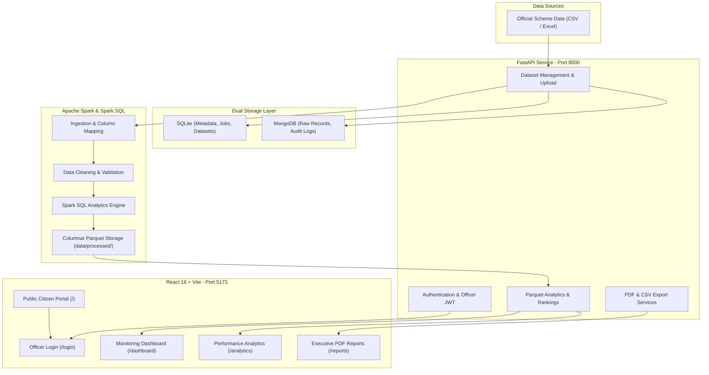

<div align="center">

# GovPulse (सार्वजनिक योजना अनुश्रवण प्रणाली)
### Public Scheme Performance Monitoring & Governance Analytics Platform

[](https://www.python.org/)
[](https://fastapi.tiangolo.com/)
[](https://spark.apache.org/)
[](https://react.dev/)
[](https://vitejs.dev/)
[](https://www.mongodb.com/)
[](https://opensource.org/licenses/MIT)

An end-to-end big-data analytics and civic transparency platform designed to ingest, process, validate, and benchmark flagship Indian welfare programs across all 31 districts of Karnataka.

</div>

---

> [!NOTE]
> **Administrative & Educational Notice**: GovPulse is designed for academic evaluation, policy research, and public administration demonstrations. All analytics, district performance indices, and anomaly alerts are computed deterministically using **Apache Spark SQL** and official open datasets from public scheme portals (including MGNREGA and PMAY-G).

---

## 🏛️ Key Platform Capabilities

### 1. Public Citizen Portal & Civic Governance
- **Official Government-Inspired Design**: Incorporates the State Lion Emblem, Indian National Tricolour accents, and clean bilingual typography (`English` & `हिन्दी`).
- **Scheme Knowledge Base**: Detailed overviews of flagship schemes, including mandate details, key performance indicators (KPIs), and target groups.
- **Citizen Communication Cell**: Official enquiry submission system with automatic ticket generation and status confirmation.
- **Full Mobile Responsiveness**: Tailored layout supporting desktop, tablet, and mobile smartphone viewports (e.g. 360px–412px Pixel/iPhone).

### 2. Role-Based Officer Workspace & Security
- **Secure Authentication**: Officer ID and password verification with session-based tokens and automatic session persistence.
- **Protected Administrative Routes**: Safeguarded routes for `/dashboard`, `/datasets`, `/schemes`, `/analytics`, `/alerts`, and `/reports`.
- **Pre-Configured Officer Account**: Instant access for evaluation (`OFFICER-KA-001` - Smt. Rajeshwari N., State Monitoring Officer).

### 3. Big Data Processing Engine (Apache Spark & Spark SQL)
- **Local Multi-Core Execution**: High-throughput distributed processing without requiring a full Hadoop cluster.
- **Column Mapping & Preprocessing**: Flexible mapping of raw government CSVs/Excel files into standardized analytical schemas.
- **Filter Pushdown & Parquet Optimization**: Analytical queries read directly from columnar Parquet files with zero query degradation.
- **Dual-Database Persistence**:
  - **SQLite**: Structured dataset registry, job statuses, and validation metadata.
  - **MongoDB**: Raw document catalogs, line-level record staging, and immutable audit logs.

### 4. Interactive Performance Analytics (4-Tab Segments)
1. **Overview & Mandate**: Statewide KPI cards, statutory compliance tracking, and target benchmarks.
2. **Regional Performance (31 Districts)**: Interactive comparative charts, top-performing vs. lagging district rankings.
3. **Financial & Social Inclusion**: Women participation tracking (e.g. 54.98% surpassing statutory 33.3% mandate) and direct benefit disbursement analytics.
4. **Progress & Time-Series Trends**: Month-by-month expenditure velocity, completion rates, and physical inspection milestones.

### 5. Automated Alerts & Data Quality Audits
- **Early-Warning Detection**: Identifies districts experiencing sluggish wage generation, stalled house construction, or low DBT verification.
- **Provenance & Integrity Tracking**: Cryptographic SHA-256 verification and immutable audit history for every ingested dataset.

### 6. Official PDF Report Generation
- **Ashoka Chakra Vector Motif & Tricolour Dividers**: High-resolution official vector artwork.
- **Executive Summaries & Metrics**: Includes comprehensive district performance tables, inclusion metrics, and timestamped officer verification footers.

---

## 📊 Monitored Schemes

| Scheme | Full Form | Administrative Ministry | Key Monitored Indicators |
| :--- | :--- | :--- | :--- |
| **MGNREGA** | Mahatma Gandhi National Rural Employment Guarantee Act | Ministry of Rural Development, GoI | Person-days generated (7.96 Cr), Women participation (54.98%), Wage expenditure (₹3,440.58 Cr), 31 Districts |
| **PMAY-G** | Pradhan Mantri Awaas Yojana – Gramin | Ministry of Rural Development, GoI | Sanctions geotagged (6,33,782), Completed homes (1,77,270), DBT bank verification (72.11%), Physical inspections (98%) |

---

## 🛠️ Architecture & System Design



---

## 📂 Repository Structure

```
GovPulse/
├── backend/                         # FastAPI Application Server
│   ├── app/
│   │   ├── main.py                  # API Gateway & Route Initializer
│   │   ├── database/
│   │   │   ├── db.py                # SQLAlchemy SQLite Engine
│   │   │   └── mongodb.py           # PyMongo Connection & Collections
│   │   ├── models/                  # ORM & Schema Models
│   │   ├── routes/                  # API Endpoints (auth, datasets, analytics, reports, contact)
│   │   └── services/                # Business logic, Spark runners & ingestion
│   ├── .env.example                 # Environment configuration template
│   └── requirements.txt             # Backend dependencies
│
├── frontend/                        # React 18 + Vite Client
│   ├── src/
│   │   ├── components/
│   │   │   ├── public/              # Citizen portal (Navbar, HeroCarousel, Schemes, etc.)
│   │   │   ├── Sidebar.jsx          # Officer dashboard navigation
│   │   │   └── TopBar.jsx           # Administrative header
│   │   ├── context/
│   │   │   └── AuthContext.jsx      # Role-based authentication provider
│   │   ├── pages/                   # Application views (Home, Login, Dashboard, Analytics, etc.)
│   │   └── utils/
│   │       └── pdfGenerator.js      # Executive PDF generation with Ashoka Chakra motif
│   ├── package.json
│   └── vite.config.js
│
├── spark_jobs/                      # Apache Spark Big Data Engine
│   ├── spark_session.py             # SparkSession builder (Local[*] + MongoDB connector)
│   ├── ingestion.py                 # CSV/Excel parser & column mapping
│   ├── preprocessing.py             # Type casting & data cleaning
│   ├── data_validation.py           # Anomaly checking & quarantine logic
│   ├── performance_queries.sql      # Spark SQL analytical statements
│   ├── analytics/                   # Scheme-specific Spark SQL jobs
│   └── jars/                        # Mongo-Spark connector JARs
│
├── scripts/                         # Administrative & Migration Utilities
│   ├── create_officer.py            # Officer account provisioner
│   ├── migrate_production_datasets.py
│   └── verify_spark_sql_analytics.py
│
├── tests/                           # Verification & Integration Test Suite
├── .gitignore                       # Strict exclusion rules (never commits .env or data/raw)
└── README.md                        # Documentation
```

---

## 🚀 Getting Started

### Prerequisites
- **Python 3.10+** (Python 3.11 / 3.12 / 3.13 supported)
- **Java 8 or 11** (Required for Apache Spark execution; OpenJDK recommended)
- **Node.js 18+** and **npm**
- **MongoDB** (Optional: Local Community Server on `localhost:27017` or MongoDB Atlas)

---

### Step 1: Clone the Repository

```bash
git clone https://github.com/ranjitanaik-dev/GOVPULSE.git
cd GOVPULSE
```

---

### Step 2: Environment Configuration

Create a `.env` file in the `backend/` directory by copying the provided example:

```bash
cp backend/.env.example backend/.env
```

The default values are configured for local development:
```env
MONGODB_URI=mongodb://127.0.0.1:27017
MONGODB_DB_NAME=govpulse_db
USE_MONGODB_SOURCE=false
```

> [!IMPORTANT]
> The `.env` file contains environment-specific settings and is strictly excluded from version control via `.gitignore`. Never commit `.env` files to git.

---

### Step 3: Backend Setup

```bash
# From the project root
python -m venv venv

# On Windows:
venv\Scripts\activate
# On Linux / macOS:
source venv/bin/activate

# Install dependencies
pip install -r requirements.txt
```

Launch the FastAPI backend:
```bash
set PYTHONPATH=backend;.
python -m uvicorn app.main:app --host 127.0.0.1 --port 8000 --reload
```
The backend API is now live at `http://127.0.0.1:8000` (Interactive Swagger Docs at `http://127.0.0.1:8000/docs`).

---

### Step 4: Frontend Setup

Open a new terminal window:

```bash
cd frontend
npm install
npm run dev -- --host 127.0.0.1
```
The React frontend is now accessible at `http://127.0.0.1:5173`.

---

## 🔐 Officer Evaluation Credentials

When evaluating the protected administrative dashboard:

| Field | Value |
| :--- | :--- |
| **Login URL** | `http://127.0.0.1:5173/login` |
| **Officer ID** | `OFFICER-KA-001` |
| **Password** | `GovPulse@2026` |
| **Role** | Smt. Rajeshwari N. (State Monitoring Officer, Karnataka) |

*(An interactive **"Auto-Fill"** button is also available directly on the login card for one-click evaluation).*

---

## 🧪 Testing & Verification

Run the test suite using `pytest`:

```bash
# Run API integration tests
pytest tests/test_api.py -v

# Run Spark SQL analytical pipeline verification
python scripts/verify_spark_sql_analytics.py
```

---

## 📄 License & Attribution

This project is released under the [MIT License](LICENSE).  
Built for academic, research, and public administration demonstration. All national insignia representations conform to civic guidelines for educational governance applications.
